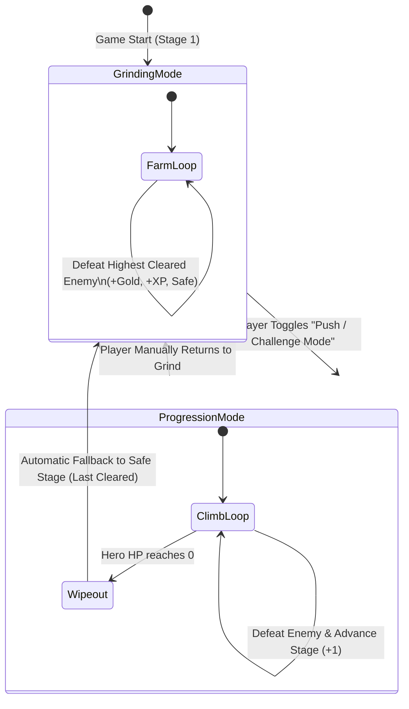
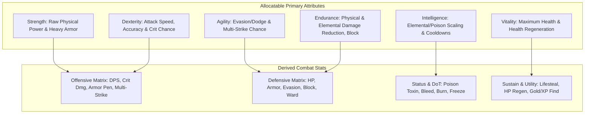
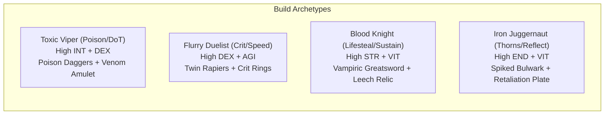
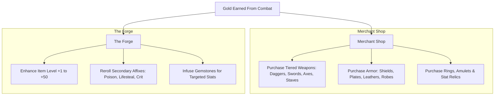

# Game Design & Technical Proposal: *Aegis Endless* (Idle RPG)

---

## 1. Executive Summary & Vision

**Aegis Endless** is a semi-automated idle RPG built around deep stat customization, high-satisfaction numeric growth, build synergies, and a dual-state combat loop. The player directs an autonomous hero through infinite stages of escalating danger, experimenting with diverse builds (e.g., Poison DoT, High-Speed Crit Assassin, Lifesteal Tank, Thorns Berserker).

### Core Pillars
1. **Uninterrupted Flow**: Zero mandatory downtime. The hero is always fighting, earning, and progressing whether actively managed or idle in the background.
2. **Deep Stat Customization & Instant Respec**: A wide variety of offensive, defensive, and elemental/status stats with instant, hassle-free point reallocation so players can freely match builds to their equipment drops.
3. **Deterministic & Impactful Progression**: Gold buys tangible equipment tiers and Forge upgrades; XP unlocks allocatable stat points and mastery perks.
4. **Risk vs. Yield Dual State**: The player chooses when to **Push** (risk wipe to unlock higher zones and new gear tiers) vs. when to **Grind** (farm optimal gold/XP per second safely at the highest cleared stage).

---

## 2. Core Game Loop & State Architecture



### The Two Combat States

| Metric | **Grinding Mode (Farm)** | **Progression Mode (Push)** |
| :--- | :--- | :--- |
| **Enemy Target** | Fixed at Highest Cleared Stage ($S_{max}$) or Player-Selected Stage | Escalating Stage ($S_{current} + 1, S_{current} + 2 \dots$) |
| **On Victory** | Respawns immediately with a brief transition animation | Progresses directly to the next stage |
| **On Defeat (HP = 0)** | N/A (hero out-scales or easily sustains on farm stage) | Instant revival with full HP; falls back to $S_{max}$ in Grinding Mode |
| **Gold / XP Yield** | Predictable, stable farming rate ($\text{Gold/min}$) | Higher reward per kill + First-Clear Stage Milestone Bonuses |
| **Unlock Conditions** | Default idle baseline | Requires player click / activation toggle |

---

## 3. Comprehensive Stat System & Point Reattribution (Respec)

### Primary Core Attributes (Allocatable Points)
Every level grants **Stat Points** that players can allocate into 6 fundamental attributes. **Players can reset and reattribute points freely at any time with a 1-click Respec button**, encouraging instant experimentation with newly acquired weapons and gear.



### Full Expanded Stat Matrix

| Category | Stat Name | Description & Formula Scaling |
| :--- | :--- | :--- |
| **Offensive** | **Attack Damage (ATK)** | Base damage inflicted on hit. Scaled by Strength & Weapon Damage. |
| | **Attack Speed (APS)** | Attacks per second (e.g. 1.0 to 5.0+ hits/sec). Scaled by Dexterity & Light Weapons. |
| | **Critical Hit Chance %** | Probability of landing a critical strike (capped at 100%). Scaled by Dexterity. |
| | **Critical Multiplier %** | Damage multiplier on critical hits (base 150%, scalable to 500%+). |
| | **Multi-Strike (Double/Triple Hit)** | Chance to instantly strike an extra time in the same swing. Scaled by Agility. |
| | **Armor Penetration %** | Ignores a percentage of the enemy's physical defense. |
| **Status & DoTs** | **Poison / Toxic Stacks** | Applies stacking venom on hit dealing nature damage per second. Stacks tick down or detonate. |
| | **Bleed Chance & Damage** | Renders enemy bleeding for physical DoT that scales with attack damage. |
| | **Burn / Ignite** | Fire DoT that reduces enemy health regeneration. |
| | **Freeze / Chill %** | Slows enemy attack speed and can temporarily freeze them in place. |
| **Defensive** | **Maximum Health (HP)** | Total life pool before death. Scaled by Vitality. |
| | **Armor & Damage Reduction %** | Mitigates incoming physical damage: $\text{DR} = \frac{\text{Armor}}{\text{Armor} + 100 \times \text{Stage}}$. |
| | **Dodge / Evasion %** | Chance to completely evade an incoming attack. Scaled by Agility. |
| | **Block Chance & Block Amount** | Chance to reduce incoming damage by a flat/percentage shield value. |
| | **Thorns / Damage Reflect** | Returns fixed + % of incoming damage back to the attacker. |
| **Sustain & Econ** | **Life Steal (Vampirism %)** | Converts a percentage of outgoing hit damage into immediate hero healing. |
| | **Health Regeneration (HP/s)** | Passive health recovered every second, even in combat. |
| | **Gold Find %** | Multiplier to all gold dropped by slain enemies. |
| | **XP Boost %** | Multiplier to all experience points earned. |
| | **Luck (Drop Quality %)** | Increases the chance of finding higher-tier item affixes and rare drops. |

---

## 4. Build Archetypes & Gear Synergies

Because points can be freely redistributed, players can tailor their attributes to specific equipment builds:



1. **The Toxic Viper (Poison & DoT Stacking)**:
   - **Focus**: High Intelligence + Dexterity. Fast attack speed to stack 20+ poison counters, combined with INT poison tick multipliers.
   - **Synergy Gear**: *Fang of the Basilisk* (Applies 2x Poison stacks), *Plague Censer* (Poison ticks 50% faster).

2. **The Flurry Assassin (Hyper-Speed & Multi-Strike Crits)**:
   - **Focus**: High Dexterity + Agility. Maximizes APS (3.5+ attacks/sec), 80%+ Crit Chance, and 40%+ Double Strike.
   - **Synergy Gear**: *Windshear Claws* (+Attack Speed per consecutive hit), *Band of Deadeye* (+Crit Multiplier).

3. **The Undying Blood Knight (Massive Lifesteal & Overheal)**:
   - **Focus**: High Strength + Vitality + Life Steal %. Sustains through massive incoming boss burst by leeching thousands of HP per hit.
   - **Synergy Gear**: *Crimson Reaper Scythe* (15% Life Steal), *Heart of the Vampire* (Excess healing converts into temporary shield).

4. **The Thorns Colossus (Full Reflect & Heavy Block)**:
   - **Focus**: Maximum Endurance + Vitality + Armor. Let enemies destroy themselves on heavy shields and reflect spikes.
   - **Synergy Gear**: *Bramble Carapace* (Reflects 300% of mitigated damage), *Aegis of the Mountain* (High Block Chance).

---

## 5. Itemization, Shop & The Blacksmith Engine



### Equipment Slots (8 Total)
1. **Main Hand**: Base Damage, Attack Speed, Primary On-Hit Effects (Poison / Bleed / Frost).
2. **Off Hand**: Shield (Block/Armor), Dual-Wield Weapon (Multi-strike), or Catalyst (DoT Multiplier).
3. **Helmet**: Vitality, Cooldown Reduction, XP Boost.
4. **Chest Armor**: Base Armor, Damage Reduction %, Thorns.
5. **Boots**: Dodge Chance %, Attack/Movement Speed, Stage Transition Speed.
6. **Ring 1**: Critical Hit Chance %, Critical Multiplier, Dexterity.
7. **Ring 2**: Poison Damage %, Bleed Multiplier, Status Chance.
8. **Amulet**: Life Steal %, Health Regeneration, Gold Find %.

---

## 6. Stages, Biomes & Boss Encounters

Every 10th stage features a **Gatekeeper Boss** requiring strategic build adaptation:

| Zone | Environment | Boss | Mechanic & Recommended Counter-Build |
| :---: | :--- | :--- | :--- |
| **1–10** | *Whispering Forest* | Treant Guardian | High HP pool; high DPS / Poison stack build |
| **11–20** | *Sunken Catacombs* | Skeletal Warlord | Heavy physical armor; Armor Penetration or Elemental DoT |
| **21–30** | *Molten Crag* | Magma Behemoth | Burns hero constantly; High Lifesteal & Health Regen build |
| **31–40** | *Frozen Citadel* | Frost Wyrm | Chills and slows attack speed; Agility / Evasion & Burst build |
| **41–50+** | *Abyssal Rift* | Void Archon | Enrage timer (30s execute); High-Speed Crit / Multi-strike build |

---

## 7. Meta-Progression: Ascension & Relics

- **Ascension (Rebirth)** unlocked at Stage 50+.
- Resets level and gold in exchange for **Ancient Shards**.
- Permanent Relic Tree:
  - *Midas Eye*: $+25\%$ Gold Find per rank.
  - *Chronos Dial*: $+10\%$ Game Speed & Attack Speed.
  - *Venom Master's Vial*: $+20\%$ Poison & Status Effect damage per rank.
  - *Vampiric Chalice*: $+2\%$ Base Lifesteal across all builds.
  - *Titan's Rib*: $+15\%$ Base HP and Armor.

---

## 8. User Interface & Visual Aesthetics

- **Sleek Cyber-Dark Fantasy** dashboard:
  - Floating dynamic colored damage splats:
    - **White**: Normal Physical Hit
    - **Gold/Amber**: Critical Strike
    - **Bright Green**: Poison / Toxic Tick
    - **Crimson**: Bleed / Lifesteal Proc
    - **Cyan**: Dodge / Block Trigger
  - **1-Click Free Respec Button**: Instant refund of all allocated stat points with live stat preview before confirming.
  - Responsive 3-panel layout: Hero & Reattribute on left, Live Animated Combat in center, Shop/Forge/Equipment on right.

```
+-----------------------------------------------------------------------------------------+
|  [AEGIS ENDLESS]   Stage 42 (Pushing)  | Gold: 1,420,500 G  | Shards: 450               |
+------------------------------+-------------------------------+--------------------------+
| HERO STATS & BUILD ENGINE    |      LIVE BATTLE ARENA        | SHOP & THE FORGE         |
|                              |                               |                          |
| Level: 68 [========] 74%     |   [HERO]             [BOSS]   | [Shop] [Forge] [Relics]  |
| HP: 4,820 / 5,000            |     |                  |      | ------------------------ |
| Total Unspent AP: 0          |  (Poison Cloud)   (Burning)   | Basilisk Fang (Dagger)   |
| [ ↻ FREE STAT RESPEC ]       |   3,840 (Crit)                | +35 ATK, +2.4 APS        |
|                              |   +1,200 (Poison DoT x14)     | +15% Poison Chance       |
| STR: 10 [+]  DEX: 45 [+]     |   +450 (Life Steal)           | Cost: 320,000 Gold       |
| AGI: 35 [+]  INT: 40 [+]     |                               |                          |
| VIT: 25 [+]  END: 15 [+]     | [<< Stage 41]  [PUSH TOGGLE]  | [Reforge Item Affixes]   |
|                              |                               | [Enhance Weapon +14]     |
| Lifesteal: 12.5% | APS: 3.1  | Current DPS: 5,120 / sec      | Cost: 110,000 Gold (70%) |
| Poison: 14 Stacks (1.2k/s)   | Highest Stage: 42             |                          |
+------------------------------+-------------------------------+--------------------------+
|  LOG: Applied 14x Poison Stacks to Void Archon! Restored 450 HP from Life Steal.        |
+-----------------------------------------------------------------------------------------+
```

---

## 9. Implementation Architecture & Next Steps

1. **Modular Engine**:
   - `StatsManager`: Handles primary stats, derived stats, equipment bonuses, and instant point respecs.
   - `CombatEngine`: Processes attack ticks, multi-strikes, lifesteal healing, and status effect DoTs (Poison/Bleed/Burn).
   - `ShopForgeManager`: Item catalog, gold transactions, item enhancement, and affix rolling.
   - `SaveSystem`: LocalStorage serialization + export/import.
2. **Phase Breakdown**:
   - **Phase 1**: Core Combat Loop (Push vs. Grind), Status Effect DoTs, and Stats/Respec Engine.
   - **Phase 2**: Tiered Equipment Shop, 8 Equipment Slots, and The Forge.
   - **Phase 3**: Biomes, 5 Gatekeeper Bosses, and Dynamic Visual Polish (Floating combat text & particle effects).
   - **Phase 4**: Ascension Rebirth System and Offline Farming Simulator.
